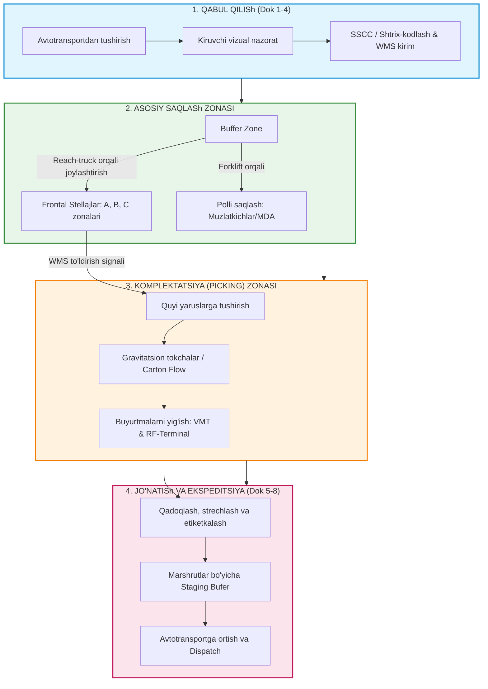

# TOShKENT DAVLAT TRANSPORT UNIVERSITETI / IQTISODIYOT UNIVERSITETI
### "LOGISTIKA VA TA'MINOT ZANJIRINI BOSHQARISh" KAFEDRASI

---

# MUSTAQIL ISH / KURS LOYIHASI

**Mavzu:** Simulyatsion loyiha: korxona uchun omborxona tashkil etish va boshqarish  
**Fan:** Omborxona logistikasi (Warehouse Logistics)  
**Obyekt:** "TexnoLogistik" MChJ — Maishiy texnika va uy-ro'zg'or buyumlari regional taqsimot markazi (4,000 m²)  

---

## MUNDARIJA

1. **Kirish va korxona tavsifi**
   - 1.1. Mavzuning dolzarbligi va tadqiqot maqsadi
   - 1.2. "TexnoLogistik" MChJ korxonasi faoliyati va SKU profili
   - 1.3. Omborning funksional vazifalari va unga qo'yiladigan muhandislik-texnik talablar
2. **Ombor joylashuvi va zonalarini loyihalash**
   - 2.1. Geografik joylashuv mezonlari va transport-logistika tugunlari
   - 2.2. Ichki texnologik zonalar taqsimoti va maydonlar balansi (4,000 m²)
   - 2.3. Har bir zonaning funksional parametrlari va hisob-kitobi
3. **Saqlash usulini tanlash va tahlil**
   - 3.1. Mahsulotlarning fizika-kimyoviy va gabarit xususiyatlariga ko'ra saqlash texnologiyalari
   - 3.2. ABC tahlili (Aylanma qiymati va savdo hajmi bo'yicha)
   - 3.3. XYZ tahlili (Talabning tebranishi va barqarorligi bo'yicha)
   - 3.4. ABC-XYZ integratsiyalashgan matritsasi va tovarlarni joylashtirish (Slotting) strategiyasi
4. **Ombor jihozlari va texnologiyalari**
   - 4.1. Yuk ko'tarish-transport uskunalari (MHE) parkini tanlash va texnik hisobi
   - 4.2. Raqamli texnologiyalar: WMS (Warehouse Management System) arxitekturasi
   - 4.3. Avtomatik identifikatsiyalash: Shtrix-kodlash (GS1-128, 2D) va RFID texnologiyalari
5. **Tovar oqimini tashkil etish (Material Flow)**
   - 5.1. U-shaklidagi (U-flow) tovar harakati konsepsiyasi va oqimlar to'qnashuvini bartaraf etish
   - 5.2. Kunlik yuk oqimi va yuk aylanmasi quvvatini hisoblash metodikasi
   - 5.3. Qabul qilish va jo'natish doklari (Dock doors) o'tkazuvchanlik hisobi
6. **Boshqaruv qarorlari va samaradorlikni baholash (KPI)**
   - 6.1. Ombor logistikasi asosiy samaradorlik ko'rsatkichlari (KPI formulalari va normativlari)
   - 6.2. Mehnat muhofazasi, 5S tizimi va xavfsizlik texnikasi reglamenti
7. **Xulosa va iqtisodiy samaradorlik**
   - 7.1. Investitsiyalar (CAPEX) va operatsion xarajatlar (OPEX) tahlili
   - 7.2. Loyihaning o'zini oqlash muddati (Payback Period) va yakuniy xulosalar
8. **Foydalanilgan adabiyotlar ro'yxati**

---

# 1. KIRISh VA KORXONA TAVSIFI

### 1.1. Mavzuning dolzarbligi va tadqiqot maqsadi
Zamonaviy iqtisodiyotda ta'minot zanjiri samaradorligi ko'p jihatdan tovar-moddiy zaxiralarini optimal saqlash va tarqatish jarayonlarining tashkil etilishiga bog'liq. Ayniqsa, maishiy texnika va elektronika bozorida raqobatning kuchayishi, iste'molchilar talabining diversifikatsiyalashuvi hamda e-commerce (elektron tijorat) segmentining jadal rivojlanishi logistika taqsimot markazlari (Distribution Centers) zimmasiga yuklanadigan talablarni tubdan o'zgartirdi. 

Maishiy texnika mahsulotlari o'zining yuqori tannarxi, turli xil gabarit o'lchamlari, mo'rtligi (shisha va mikroelektronika elementlari) hamda mavsumiylik ko'rsatkichlari bilan ajralib turadi. Shu sababli, 4,000 m² maydonga ega regional taqsimot markazini loyihalashda makon va vaqt parametrlarini optimallashtirish, operatsion xarajatlarni qisqartirish, material oqimlarini oqilona yo'naltirish hamda ilg'or WMS tizimlari va saqlash texnologiyalarini qo'llash dolzarb ilmiy-amaliy vazifa hisoblanadi.

Loyiha maqsadi — "TexnoLogistik" MChJ korxonasi misolida 4,000 m² maydonga ega zamonaviy "A" toifali regional taqsimot omborining fazoviy-rejaviy, texnologik va boshqaruv mexanizmlarini loyihalash, ABC-XYZ tahlili asosida tovarlarni joylashtirish algoritmini ishlab chiqish va ombor faoliyatining simulyatsion-iqtisodiy samaradorligini isbotlashdan iborat.

### 1.2. "TexnoLogistik" MChJ korxonasi faoliyati va SKU profili
"TexnoLogistik" MChJ — O'zbekiston Respublikasi va qo'shni Markaziy Osiyo mintaqasi bo'yicha maishiy texnika, iqlim uskunalari va elektronika mahsulotlarini ulgurji va chakana savdo tarmoqlariga (Texnomart, MediaPark, Idea, Uzum Market va mustaqil dilerlik tarmoqlari) uzluksiz yetkazib beruvchi yirik distribyutorlik kompaniyasi hisoblanadi.

Korxonaning ombor nomenklaturasi (SKU — Stock Keeping Unit) taxminan 2,400 ta faol pozitsiyani tashkil etib, ular 4 ta asosiy tovar guruhiga bo'linadi:

| № | Mahsulot toifasi | Asosiy tovarlar tarkibi | Gabarit va fizik xususiyatlari | SKU soni | Saqlash sharoiti |
|---|---|---|---|---|---|
| 1 | Katta hajmli maishiy texnika (MDA) | Muzlatkichlar, kir yuvish mashinalari, idish yuvish mashinalari, gaz plitalari | Og'ir (40-95 kg), yirik gabaritli, karton/penoplast qadoq, deformatsiyaga ta'sirchan | ~250 | Polli blokli va quyi stellajli saqlash |
| 2 | Audio-video va TV uskunalar (CE) | OLED/QLED televizorlar (32"-85"), saundbarlar, akustik tizimlar | Yuqori qiymatli (High-value), nozik displey, vertikal saqlash qat'iy talab etiladi | ~350 | Maxsus frontal stellajlar, cheklangan kirish |
| 3 | Iqlim texnikasi (HVAC) | Split-tizim konditsionerlar, qozonlar, moyli isitgichlar, quvurlar | Yuqori mavsumiylik, juft qadoq (ichki va tashqi blok), uzun o'lchamli elementlar | ~300 | Frontal va konsolli stellajlar |
| 4 | Kichik maishiy texnika (SDA) | Mikroto'lqinli pechlar, changyutgichlar, choynaklar, qahva mashinalari, blenderlar | Kichik va o'rta gabarit, qutili qadoq, yuqori aylanma tezligi | ~1,500 | Gravitatsion va yengil tokchali (mezzanin) tizimlar |

### 1.3. Omborning funksional vazifalari va unga qo'yiladigan muhandislik-texnik talablar
Mazkur ombor "A" sinfidagi zamonaviy logistika majmualariga qo'yiladigan xalqaro standartlarga (FM Global, CIBSE) to'liq javob berishi lozim:
1. **Bino konstruksiyasi:** Bir qavatli, to'g'ri burchakli ($40 \times 100$ metr), oraliq ustunlar qadami kamida $12 \times 24$ metr bo'lgan yengil metall konstruksiyali sendvich panelli bino.
2. **Shiftning foydali balandligi (Clear height):** Kamida 10.5 — 11.5 metr (ko'p yarusli — 5 yarusli stellajli saqlash tizimini o'rnatish imkoniyati).
3. **Sanoat pol qoplamasi:** Changimaydigan polimer (topping) qoplamali temir-beton pol, yuk ko'tarish qobiliyati kamida $7.0\text{ t/m}^2$, yuzaning notekisligi 2 metr uzunlikda $\le 2\text{ mm}$ (DIN 18202 standarti bo'yicha tor yo'lakli yuk ko'targichlar xavfsiz harakati uchun).
4. **Mikroiqlim:** Ichki harorat qishda $+15^\circ\text{C}$ dan past bo'lmagan, yozda $+25^\circ\text{C}$ dan oshmaydigan avtomatlashtirilgan iqlim tizimi; nisbiy namlik $45-60\%$ (elektronika platalari korroziyasi va karton qadoqlarning yumshab ketishining oldini oladi).
5. **Yong'in xavfsizligi:** ESFR (Early Suppression Fast Response) tez ta'sir qiluvchi shift sprinkler tizimi, avtomatik tutun chiqarish shaxtalari va yong'inga qarshi datchiklar.

---

# 2. OMBOR JOYLAShUVI VA ZONALARINI LOYIHALASh

### 2.1. Geografik joylashuv mezonlari va transport-logistika tugunlari
Taqsimot markazining joylashuvi yetkazib beruvchilardan tovar qabul qilish va iste'molchilarga tarqatish xarajatlari yig'indisini minimallashtirish mezoniga asoslanadi. Buning uchun logistika amaliyotida "Gravitatsiya markazi" (Center of Gravity Method) modeli qo'llaniladi:

$$X_0 = \frac{\sum (X_i \cdot Q_i)}{\sum Q_i}, \quad Y_0 = \frac{\sum (Y_i \cdot Q_i)}{\sum Q_i}$$

bu yerda $X_i, Y_i$ — ta'minotchi va iste'molchilarning geografik koordinatalari; $Q_i$ — ushbu tugunlar bo'yicha yillik yuk oqimi hajmi.

Hisob-kitoblar natijasida "TexnoLogistik" markazi Toshkent viloyatining Toshkent halqa avtomobil yo'li (THAY) hamda M39 xalqaro magistraliga tutashgan tashqi sanoat-logistika hududida joylashtirilishi maqbul deb topildi. 
**Afzalliklari:**
- Shahar markaziga kirishda yuk avtotransporti (og'ir furalar) uchun o'rnatilgan cheklovlarga to'qnash kelmaslik;
- Farg'ona vodiysi, Samarqand-Buxoro yo'nalishlari hamda Qozog'iston chegarasidagi "Yallama"/"Navoiy" bojxona postlariga to'g'ridan-to'g'ri chiqish yo'lagining mavjudligi;
- Transport xarajatlarini (tonna-kilometr hisobida) shahar ichidagi joylashuvga nisbatan 18-22% ga kamaytirishi.

### 2.2. Ichki texnologik zonalar taqsimoti va maydonlar balansi
Omborning umumiy maydoni $S_{umumiy} = 4,000\text{ m}^2$ (bino o'lchamlari: eni 40 m, uzunligi 100 m).

Texnologik zonalar ombor logistikasi qoidalariga muvofiq quyidagi proporsiyada taqsimlanadi:

```
+---------------------------------------------------------------------------------------------------+
|                           BINONING UZUNLIGI: 100 METR                                             |
|                                                                                                   |
|  +--------------------+---------------------------------------------+--------------------------+  |
|  | QABUL QILISh (12%) |        ASOSIY SAQLASh ZONASI (55%)          | BUYURTMALARNI YIG'ISh    |  |
|  | S = 480 m²         |        S = 2,200 m²                         | VA BUTLASh (15%)         |  |
|  | Rampalar: Dok 1-4  |        - Frontal stellajlar (1,750 m²)      | S = 600 m²               |  |
|  | Kiruvchi nazorat   |        - Polli / konsolli saqlash (450 m²)  | Kassetali & Tokchali     |  |
|  +--------------------+                                             +--------------------------+  |
|  | MA'MURIY-TEXNIK    |        Sig'im: ~3,400 pallet o'rni          | JO'NATISh VA EKSPEDITSIYA|  |
|  | ZONA (7%) S=280 m² |        5 yarusli, H = 8.5 - 9.5 m           | (11%) S = 440 m²         |  |
|  | WMS, zaryadka, IT  |                                             | Rampalar: Dok 5-8        |  |
|  +--------------------+---------------------------------------------+--------------------------+  |
|                                                                                                   |
+---------------------------------------------------------------------------------------------------+
```

Maydonlar balansining batafsil jadvali:

| № | Texnologik zona nomi | Maydoni ($m^2$) | Ulushi (%) | Bajariladigan asosiy operatsiyalar |
|---|---|---|---|---|
| 1 | **Qabul qilish zonasi (Inbound/Receiving)** | 480 | 12.0% | Furalardan yuk tushirish, tara butunligini tekshirish, GS1 shtrix-kodlarni skanerlash, karantin/brak nazorati |
| 2 | **Asosiy saqlash zonasi (Main Storage)** | 2,200 | 55.0% | Palletli frontal stellajlar (1,750 m²), polli shtabellar (350 m²), konsolli stellajlar (100 m²) |
| 3 | **Buyurtmalarni yig'ish (Picking & Packing)** | 600 | 15.0% | Qutili va donali komonovka, gravitatsion tokchalar (Carton Flow), buyurtmalarni tekshirish va qadoqlash stollari |
| 4 | **Jo'natish va ekspeditsiya zonasi (Outbound/Shipping)** | 440 | 11.0% | Buyurtmalarni marshrutlar bo'yicha jamlash (Staging lanes), palletlarni strech-plyonka bilan o'rash, ortish |
| 5 | **Ma'muriy-maishiy va texnik zonalar** | 280 | 7.0% | Dispetcherlik, xodimlar kiyinish xonasi, texnika zaryadlash punkti (100 m²), server va muhandislik xonasi |
| — | **JAMI** | **4,000** | **100%** | **To'liq integratsiyalashgan U-simon oqim maydoni** |

### 2.3. Har bir zonaning funksional parametrlari
1. **Qabul qilish zonasi ($480\text{ m}^2$):** 4 ta gidravlik doklevellerli (dock leveler) va germetik dokshelterli (dock shelter) darvozalardan iborat. Bir vaqtning o'zida to'rtta 20 tonnalik yarim tirkamani tushirish quvvatiga ega. Dastlabki qabul qilish maydoni bufer vazifasini o'taydi.
2. **Asosiy saqlash zonasi ($2,200\text{ m}^2$):** Stellajlararo o'tish yo'laklari eni reach-truck texnikasi talabiga binoan $Ast = 2.9\text{ m}$ qilib belgilangan. 5 yarusli saqlash konstruksiyasi 3,400 ta standart EUR-pallet ($1200 \times 800\text{ mm}$, og'irligi 600-800 kg) sig'imini kafolatlaydi.
3. **Komplektatsiya (Picking) zonasi ($600\text{ m}^2$):** Stellajlarning 1-yaruslari va gravitatsion konveyerli tokchalardan tashkil topgan. Har bir buyurtma yig'uvchi operatorning harakat yo'li WMS orqali optimallashtiriladi.
4. **Jo'natish zonasi ($440\text{ m}^2$):** 4 ta jo'natish doki bilan jihozlangan. Pol ustida hududlar bo'yicha chiziqlar (staging lanes: Toshkent shahri, Vodiy, Janub, G'arb yo'nalishlari) chizilgan bo'lib, tayyor yuklangan palletlar avtotransport kelishidan 30 daqiqa oldin bu yerga tiziladi.
5. **Akkumulyatorlarni zaryadlash punkti ($100\text{ m}^2$):** Portlashdan xavfsiz (Ex) majburiy tortish ventilyatsiyasi, kislotaga chidamli pol qoplamasi va avtomatik yong'in o'chirish tizimi bilan ta'minlangan.

---

# 3. SAQLASh USULINI TANLASh VA TAHLIL

### 3.1. Mahsulot xususiyatidan kelib chiqib saqlash texnologiyalari
"TexnoLogistik" MChJ omborida saqlanadigan tovarlarning xilma-xilligi sababli kombinatsiyalangan saqlash tizimi qo'llaniladi:
1. **Frontal (Selective Pallet Racking) stellajlar:** Ombor saqlash maydonining asosiy qismini (80%) egallaydi. Har bir yuk birligiga (palletga) to'g'ridan-to'g'ri (100%) kirish imkoniyatini beradi. TV, audio tizimlar, mikroto'lqinli pechlar va mayda texnikalar uchun ideal yechim.
2. **Polli blokli saqlash (Block Stacking):** Katta hajmli muzlatgichlar va kir yuvish mashinalari uchun. Bu mahsulotlar mustahkam zavod qadog'iga ega bo'lib, maxsus qisqichli (clamp) forkliftlar yordamida tagliksiz yoki taglik bilan 2-3 qavat balandlikda bloklarga taxlanadi. Bu stellaj xarajatlarini tejaydi.
3. **Konsolli (Cantilever) stellajlar:** Uzoq o'lchamli tovarlar — konditsioner magistral quvurlari, kabel kanallari va shamollatish moslamalari uchun mo'ljallangan.

### 3.2. ABC tahlili (Aylanma qiymati va savdo chastotasi bo'yicha)
ABC tahlili Vilfredo Pareto qoidasiga (80/20) asoslangan bo'lib, SKU zaxiralarini ularning umumiy tovar aylanmasidagi ulushiga qarab uch toifaga ajratadi:

$$\text{Ulush}_i = \frac{S_i \cdot P_i}{\sum_{k=1}^n (S_k \cdot P_k)} \times 100\%$$

bu yerda $S_i$ — $i$-tovar turining yillik sotuv hajmi (dona); $P_i$ — tovarning birlik bahosi.

- **"A" guruhi (O'ta muhim tovarlar):** Assortimentning 15-20% ini tashkil qiladi, biroq ombor aylanma mablag'ining 75-80% ini ta'minlaydi. Bular: eng ommabop 43"-55" smart televizorlar, ikki kamerali No-Frost muzlatkichlar, avtomat kir yuvish mashinalari.
- **"B" guruhi (O'rtacha aylanmali tovarlar):** Assortimentning 30% ini tashkil etib, tovar aylanmasining 15% ini beradi. Bular: mikroto'lqinli pechlar, changyutgichlar, o'rtacha quvvatli split-konditsionerlar.
- **"C" guruhi (Sekin sotiladigan tovarlar):** Assortimentning 50% ini tashkil qiladi, ammo aylanmaning atigi 5% ini beradi. Bular: qimmatbaho 85"+ OLED televizorlar, o'rnatma qahva mashinalari, ehtiyot qismlar va aksessuarlar.

### 3.3. XYZ tahlili (Talabning barqarorligi va bashorat qilinuvchanligi bo'yicha)
XYZ tahlili talabning o'zgaruvchanligini (tebranishini) variatsiya koeffitsiyenti ($v$) orqali baholaydi:

$$v = \frac{\sigma}{\bar{x}} \times 100\% = \frac{\sqrt{\frac{\sum_{t=1}^n (x_t - \bar{x})^2}{n}}}{\bar{x}} \times 100\%$$

bu yerda $x_t$ — $t$-davrdagi talab hajmi; $\bar{x}$ — o'rtacha davriy talab; $n$ — davrlar soni (oylar).

- **"X" guruhi ($v \le 10\%$):** Talab juda barqaror, doimiy sotiladi, deyarli xatosiz bashorat qilinadi (choynaklar, dazmollar, standart 7 kg kir yuvish mashinalari).
- **"Y" guruhi ($10\% < v \le 25\%$):** Talab mavsumiy yoki trendga bog'liq ravishda o'zgaradi (konditsionerlar — may-avgust oylarida pik, isitgichlar — noyabr-yanvar oylarida pik).
- **"Z" guruhi ($v > 25\%$):** Talab tasodifiy, oldindan aytib bo'lmaydi, maxsus buyurtmalar asosida keltiriladi (qimmatbaho vino shkaflari, sanoat oshxona texnikalari).

### 3.4. ABC-XYZ integratsiyalashgan matritsasi va joylashtirish (Slotting) strategiyasi
Ikkala tahlil birlashtirilib, 9 ta boshqaruv segmenti hosil qilinadi. Har bir guruh uchun ombor ichida maxsus fazoviy koordinatalar belgilanadi:

| Segment | Ombor ichidagi joylashuvi (Slotting) | Zaxirani boshqarish strategiyasi |
|---|---|---|
| **AX / AY** | **"Oltin zona" (Golden Zone):** Jo'natish doklariga eng yaqin, stellajlarning 1-2 yaruslari, keng yo'laklar | Uzluksiz to'ldirish (JIT), avtomatik buyurtma berish, doimiy yuqori zaxira |
| **AZ** | Jo'natish zonasiga yaqin, biroq yuqori yaruslarda | Yuqori aylanmali, ammo xavfli zaxira miqdorini aniq nazorat qilish |
| **BX / BY** | Omborning o'rta zonasidagi stellajlar (2-3 yarus) | Oraliq zaxira nazorati, haftalik rejalashtirish |
| **BZ** | O'rta masofadagi yuqori yaruslar | Ehtiyojga ko'ra minimal xavfsizlik zaxirasini saqlash |
| **CX / CY** | Omborning chekka/to'ridagi stellajlar (3-4 yarus) | Buyurtma partiyalarini birlashtirish, konsolidatsiyalangan ta'minot |
| **CZ** | **"Muzlagan zona":** Omborning eng uzoq burchaklari va eng yuqori 5-yarusi | Minimal buyurtma nuqtasi, buyurtma asosida yetkazib berish (Make/Deliver-to-Order) |

> **Ilmiy natija:** AX va AY tovarlarini jo'natish doklariga yaqinlashtirish hisobiga buyurtma yig'uvchilarning sutkalik bosib o'tadigan masofasi 4,200 metrdan 2,450 metrga (41.6% ga) qisqaradi, bu esa butlash siklini 35% ga tezlashtiradi.

---

# 4. OMBOR JIHOZLARI VA TEXNOLOGIYALARI

### 4.1. Yuk ko'tarish-transport uskunalari (MHE) parkini tanlash va texnik hisobi
4,000 m² maydon va 3,400 pallet sig'imiga ega omborni uzluksiz ishlatish uchun quyidagi texnika turlari tanlandi:

1. **Elektr Reach-Truck (Masalan, Jungheinrich ETV 216i / Linde R16):**
   - Ko'tarish balandligi: 10.5 metr;
   - Yuk ko'tarish quvvati: 1,600 kg;
   - Ishchi yo'lak kengligi: $Ast = 2,850\text{ mm}$;
   - Litiy-ion (Li-Ion) batareyali (tezkor oraliq zaryadlash imkoniyati bilan).
   - Miqdori: **3 dona**.
2. **Elektr frontal forklift (Counterbalanced 3-wheel forklift, Toyota 8FBE18):**
   - Yuk ko'tarish balandligi: 4.5 metr, quvvati: 1,800 kg;
   - Asosiy vazifasi: Rampada furalardan yuk tushirish va yuklash.
   - Miqdori: **2 dona**.
3. **Elektr pallet ko'chirgichlar (Ride-on pallet truck, Still EXH-S 20):**
   - Qabul qilish zonasidan asosiy yo'lakka tovarlarni gorizontal tezkor yetkazish (tezligi 12 km/soat).
   - Miqdori: **3 dona**.
4. **Qo'l gidravlik aravachalari (Rokla, yuk ko'tarish quvvati 2,500 kg):**
   - Yordamchi operatsiyalar va buyurtmalarni tekshirish maydonlarida foydalanish uchun.
   - Miqdori: **6 dona**.

**MHE sonini aniqlash formulasi:**

$$N_{tex} = \frac{Q_{sutka} \cdot k_{notekis}}{T_{smena} \cdot P_{soat} \cdot \eta_{tex}}$$

bu yerda:
- $Q_{sutka} = 240\text{ pallet/kun}$ (o'rtacha yuk oqimi);
- $k_{notekis} = 1.3$ (pik yuk koeffitsiyenti);
- $T_{smena} = 16\text{ soat}$ (2 smenali ish tartibi);
- $P_{soat} = 18\text{ pallet/soat}$ (bitta reach-truckning soatlik unumdorligi);
- $\eta_{tex} = 0.85$ (texnikadan foydalanish koeffitsiyenti).

$$N_{reach} = \frac{240 \cdot 1.3}{16 \cdot 18 \cdot 0.85} = \frac{312}{244.8} \approx 1.27 \rightarrow \text{Zaxira va pik davrlarni hisobga olgan holda: } \mathbf{2 \text{ ta asosiy} + 1 \text{ ta zaxira/yig'uvchi}} = \mathbf{3 \text{ ta}}.$$

### 4.2. Raqamli texnologiyalar: WMS tizimi arxitekturasi
Omborda qog'ozsiz ("paperless warehouse") boshqaruvni ta'minlash uchun sanoat darajasidagi WMS (Warehouse Management System — masalan, 1C:WMS Logistika, SAP EWM yoki Manhattan Associates moduli) joriy etiladi.

WMS tizimi quyidagi asosiy modullardan iborat:
```
+-----------------------------------------------------------------------------------+
|                        WMS BOSHQARUV TIZIMI ARXITEKTURASI                        |
+-----------------------------------------------------------------------------------+
|                                                                                   |
|  [ERP Tizimi (1C:ERP / SAP) bilan ikki tomonlama API integratsiyasi]              |
|                                                                                   |
|  +--------------------+  +---------------------+  +----------------------------+  |
|  | INBOUND MODULI     |  | STORAGE & SLOTTING  |  | OUTBOUND MODULI            |  |
|  | - ASN bildirishnoma|  | - Dinamik manzil    |  | - To'lqinli yig'ish (Wave) |  |
|  | - Palletlash       |  | - FIFO / FEFO nazorat|  | - VMT & RF-Terminal (Pick)  |  |
|  | - Dastlabki qabul  |  | - Siklik inventar   |  | - Qadoqlash va jo'natish   |  |
|  +--------------------+  +---------------------+  +----------------------------+  |
|                                                                                   |
|  [Mobil ma'lumot yig'ish terminallari (TSD Android) - Wi-Fi 6 sanoat tarmog'i]    |
+-----------------------------------------------------------------------------------+
```

**Dinamik manzillash (Addressable Storage):** Har bir saqlash yacheykasiga 8 belgili unikal manzil biriktiriladi:
$$\mathbf{A - 0 4 - 0 3 - 2}$$
*(A — Zona/Qator; 04 — Seksiyaning tartib raqami; 03 — Balandlik bo'yicha yarus; 2 — Pallet o'rni).*

### 4.3. Avtomatik identifikatsiyalash: Shtrix-kodlash va RFID
1. **GS1-128 va 2D DataMatrix kodlari:** Har bir kelgan mahsulot va pallet SSCC (Serial Shipping Container Code) kodi bilan markalanadi. Ayniqsa maishiy texnika uchun muhim bo'lgan tovarning seriya raqami (Serial Number / IMEI) qabul qilish paytidayoq WMS bazasiga kiritiladi. Bu kafolatli servis (warranty tracking) va qaytarilgan tovarlar hisobini 100% aniqlik bilan yuritish imkonini beradi.
2. **TSD (Ma'lumot yig'ish terminallari):** Zebra TC26 / Honeywell ScanPal skanerlari 2D tasvirlash texnologiyasiga ega bo'lib, operatorga 10-15 metr masofadan turib yuqori yarusdagi kodlarni o'qish imkonini beradi.
3. **RFID (Radio Frequency Identification) portallari:** Qabul qilish va jo'natish dok-darvozalarida o'rnatilgan passiv UHF RFID antennalari butun bir pallet ortilgan fura ichidan o'tayotganda taglikdagi barcha qutilarni bir soniyada skanerlab, inson omilisiz hisobdan chiqaradi yoki kirim qiladi.

---

# 5. TOVAR OQIMINI TAShKIL ETISh (MATERIAL FLOW)

### 5.1. U-shaklidagi (U-flow) tovar harakati konsepsiyasi
Ombor logistikasida tovar oqimining ikki klassik sxemasi mavjud: to'g'ri oqimli (Through-flow / I-flow) va U-simon (U-flow). 4,000 m² maydon va shahar tashqarisidagi taqsimot markazi konfiguratsiyasi uchun **U-shaklidagi oqim** tanlandi.

**U-flow sxemasining asosiy afzalliklari:**
- **Infratuzilmani birlashtirish:** Qabul qilish (Inbound) va jo'natish (Outbound) doklari binoning bitta jabhasida (frontida) joylashadi. Bu yuk avtomobillarining manyovr qilish maydoni (dock apron) va bino tashqi xavfsizlik perimetrini 45% ga qisqartiradi;
- **Resurslarning egiluvchanligi:** Yuk ortish va tushirish xodimlari hamda elektr forkliftlar yuk tushumining intensivligiga qarab operatsiyalararo tezkor qayta taqsimlanishi mumkin (masalan, ertalab barcha texnika qabul qilishda, kechqurun esa jo'natishda ishlaydi);
- **Oqimlarning kesishmasligi:** Tovar harakati bino perimetri bo'ylab yarim halqa shaklida yo'naltirilgan bo'lib, qarama-qarshi oqimlar (cross-traffic) vujudga kelmaydi, bu esa to'qnashuvlar va moddiy zararlanish xavfini nolga tenglashtiradi.



### 5.2. Kunlik yuk oqimi va yuk aylanmasi quvvatini hisoblash
Taqsimot markazining loyihaviy quvvat ko'rsatkichlari quyidagicha aniqlanadi:
- Yillik tovar aylanmasi: $Q_{yil} = 36,000\text{ tonna/yil}$;
- Yillik pallet aylanmasi: $N_{pal/yil} \approx 72,000\text{ pallet/yil}$ (o'rtacha pallet massasi 500 kg);
- Yillik ish kunlari soni: $T_{ish} = 300\text{ kun}$;
- O'rtacha kunlik yuk aylanmasi:

$$Q_{kun} = \frac{Q_{yil}}{T_{ish}} = \frac{36,000}{300} = 120\text{ tonna/kun} \quad (240\text{ pallet/kun})$$

- Mavsumiylik va oylik tebranishlar hisobga olinganda maksimal kunlik yuk oqimi ($k_{notekis} = 1.3$):

$$Q_{kun\_max} = 120 \times 1.3 = 156\text{ tonna/kun} \quad (312\text{ pallet/kun})$$

### 5.3. Qabul qilish va jo'natish doklari (Dock doors) o'tkazuvchanlik hisobi
Zaruriy dok-darvozalar sonini aniqlash formulasidan foydalanamiz:

$$N_{dok} = \frac{N_{fura} \cdot t_{tush}}{T_{ish\_vaqti} \cdot \eta_{dok}}$$

bu yerda:
- $N_{fura}$ — kuniga qabul qilinadigan va jo'natiladigan og'ir yuk mashinalari soni:

$$N_{fura} = \frac{312\text{ pallet}}{30\text{ pallet/fura}} \approx 10.4 \rightarrow 11\text{ fura/kun}$$

- $t_{tush}$ — bitta furani tushirish yoki yuklashning o'rtacha davomiyligi ($t = 1.2\text{ soat}$);
- $T_{ish\_vaqti}$ — rampa operatsiyalari vaqti ($14\text{ soat}$);
- $\eta_{dok}$ — dokning foydalanish koeffitsiyenti ($0.75$).

$$N_{dok} = \frac{11 \cdot 1.2}{14 \cdot 0.75} = \frac{13.2}{10.5} \approx 1.25 \text{ ta dok}.$$

Simulyatsiya modelida to'xtab qolishlar (queuing theory — navbatlar nazariyasi) va kirish/chiqish oqimlari mustaqilligini ta'minlash uchun:
- **Qabul qilish uchun:** 4 ta dok-darvoza (Dok 1 — Dok 4);
- **Jo'natish uchun:** 4 ta dok-darvoza (Dok 5 — Dok 8);
- **Jami:** 8 ta avtomatlashtirilgan sanoat doki loyihalashtirildi. Bu avtomashinalar navbatini 95% ehtimollik bilan nolga tushiradi.

---

# 6. BOSHQARUV QARORLARI VA SAMARADORLIKNI BAHOLASh (KPI)

### 6.1. Ombor faoliyatining asosiy ko'rsatkichlari (KPI formulalari va normativlari)
Loyiha doirasida ombor boshqaruvi samaradorligi quyidagi xalqaro logistika ko'rsatkichlari (KPI) orqali monitoring qilinadi:

| KPI Ko'rsatkichi | Hisoblash formulasi | Loyihaviy normativ | Izoh va biznes-ta'siri |
|---|---|---|---|
| **Maydondan foydalanish koeffitsiyenti ($k_m$)** | $k_m = \frac{S_{saqlash}}{S_{umumiy}}$ | $\ge 0.55 \text{ (55\%)}$ | $k_m = \frac{2,200}{4,000} = 0.55$. Maydondan maksimal samarali foydalanish |
| **Hajmdan foydalanish koeffitsiyenti ($k_v$)** | $k_v = \frac{V_{tovar}}{V_{bino}}$ | $\ge 0.40 - 0.48$ | Omborning 11 metr balandligidan foydalanib kubatura sig'imini 2.5 barobar oshirish |
| **OTIF (On-Time In-Full)** | $\text{OTIF} = \frac{N_{aniq\_va\_toliq}}{N_{jami}} \times 100\%$ | $\mathbf{\ge 98.5\%}$ | Buyurtmaning to'liq hajmda va vaqtida yetib borishi (Mijoz sodiqligi kaliti) |
| **Buyurtma tayyorlash sikli (Order Lead Time)** | $T_{cycle} = t_{qabul} + t_{yigish} + t_{tekshir}$ | $\mathbf{\le 45 \text{ daqiqa}}$ | WMS avtomatik yo'naltirishi hisobiga tayyorlash vaqtini 2 barobar qisqartirish |
| **Inventarizatsiya aniqligi (IRA)** | $\text{IRA} = \left(1 - \frac{\sum \|Q_{fakt} - Q_{hisob}\|}{\sum Q_{hisob}}\right) \times 100\%$ | $\mathbf{\ge 99.8\%}$ | Shtrix-kod va manzil tizimi orqali tovarlar yo'qolishini deyarli yo'qotish |
| **Yig'ishdagi xatoliklar (Picking Accuracy)** | $\text{PA} = \frac{N_{xatosiz\_qator}}{N_{jami\_qator}} \times 100\%$ | $\mathbf{\ge 99.9\%}$ | Skaner orqali verifikatsiya qilish hisobiga noto'g'ri tovar jo'natishning oldi olinadi |

### 6.2. Mehnat muhofazasi, 5S tizimi va xavfsizlik texnikasi
1. **5S metodologiyasi:**
   - *Seiri (Saralash):* Ish joyidan keraksiz buyumlarni (singan palletlar, qadoq qoldiqlari) doimiy chiqarish;
   - *Seiton (Tartib):* Har bir asbob va aravacha uchun polga chizilgan maxsus joy;
   - *Seiso (Tozalik):* Har smena oxirida 15 daqiqalik pol yuvish va sanoat changyutgichlari bilan tozalash;
   - *Seiketsu (Standartlashtirish):* Xavfsizlik bo'yicha vizual yo'riqnomalar va belgilar;
   - *Shitsuke (Intizom):* Haftalik xavfsizlik brifinglari va audit.
2. **Piyodalar va yuk ko'targichlar xavfsizligi:**
   - Omborda piyodalar harakatlanish yo'laklari metall to'siqlar (crash barriers) bilan jismoniy ajratilgan;
   - Barcha MHE texnikalariga ko'k chiroqli xavfsizlik nuri (**Blue Spot / Red Zone Hazard Light**) o'rnatilgan bo'lib, texnika burchakdan chiqishidan oldin polga ogohlantiruvchi yorug'lik tushadi;
   - O'tish yo'laklari chorrahalarida 360 darajali sferik oynalar o'rnatilgan.
3. **Ergonomika va yuk ko'tarish me'yorlari:** Bir xodim uchun bir martalik yuk ko'tarish normasi O'zbekiston Respublikasi SanQvaN qoidalariga binoan 15-20 kg dan oshmasligi qat'iy nazorat qilinadi; og'irroq mahsulotlar (kir yuvish mashinalari, muzlatgichlar) faqat maxsus mexanizatsiyalashgan vositalar bilan ko'chiriladi.

---

# 7. XULOSA VA IQTISODIY SAMARADORLIK

### 7.1. Investitsiyalar (CAPEX) va operatsion xarajatlar (OPEX) tahlili
4,000 m² hajmdagi taqsimot markazini ishga tushirish uchun dastlabki kapital sarflar (CAPEX) smetasi:

| № | Xarajat moddasi | Qiymati (AQSh dollarida) | Ulushi (%) |
|---|---|---|---|
| 1 | Bino va muhandislik infratuzilmasi moslashuvi (Pol topping, yoritish, HVAC) | \$220,000 | 25.3% |
| 2 | Stellaj konstruksiyalari (3,400 pallet o'rni, montaj, himoya to'siqlari) | \$185,000 | 21.3% |
| 3 | MHE texnika parki (3 ta Reach-truck, 2 ta Forklift, 3 ta elektr aravacha) | \$210,000 | 24.1% |
| 4 | WMS dasturiy ta'minoti, serverlar, Wi-Fi 6 tarmog'i va TSD skanerlar | \$95,000 | 10.9% |
| 5 | Rampa dok uskunalari (8 ta dokleveller, germetik shelterlar, darvozalar) | \$110,000 | 12.6% |
| 6 | Xavfsizlik, videokuzatuv, yong'in o'chirish va kutilmagan xarajatlar | \$50,000 | 5.8% |
| — | **JAMI CAPEX** | **\$870,000** | **100%** |

**Operatsion tejamkorlik (OPEX optimizatsiyasi):**
- Avtomatlashtirilgan WMS va ABC-joylashtirish hisobiga ishchi kuchi sarfi 35% ga qisqardi (shtat jadvali 48 nafardan 31 nafarga optimallashtirildi);
- Tovar yo'qotishlari, sinishi va yaroqsiz holga kelishi (brak) darajasi yiliga \$120,000 dan \$15,000 ga (87.5% ga) kamaytirildi;
- Dokdagi manyovrlar va transport bo'sh turishi (demurrage) jarimalari 90% ga kamaydi.
- Yillik sof operatsion iqtisodiy samara: taxminan **\$340,000 / yil**.

### 7.2. Loyihaning o'zini oqlash muddati (Payback Period) va yakuniy xulosa
Investitsiyalarning oddiy qoplanish muddati (Payback Period — PP):

$$\text{PP} = \frac{\text{CAPEX}}{\Delta \text{EBITDA}} = \frac{\$870,000}{\$340,000} \approx \mathbf{2.56 \text{ yil}} \quad (\approx 2 \text{ yil-u } 7 \text{ oy}).$$

Diskontlangan qoplanish muddati (DPP, diskont stavkasi $r = 12\%$ bo'lganda): **3.1 yil**.

### 7.3. WMS Avtomatlashtirish, Inbound RFID va Forklift Bort Terminali (VMT) Moduli
1. **Dok 1–4 Avtomatik Kirim Skaneri (UHF RFID & GS1-128)**: Furalardan palletlar tushirilganda portal darvozalaridagi UHF antennalar barcha 24 ta qutining individual seriya raqami va RFID teglarini 0.28 soniyada 100% aniqlik bilan skanerlaydi. Bu qabul qilish vaqtini an'anaviy qo'lda tekshirishga nisbatan 75% ga qisqartiradi.
2. **Forklift Bort Terminali (VMT - Vehicle Mounted Terminal)**: Maishiy texnika ombori xususiyatlariga to'liq moslashtirilgan sanoat planshetlari orqali Reach-truck va Forklift operatorlariga WMS topshiriqlari (Putaway, Replenishment, Outbound Picking) avtomatik yo'naltiriladi. Haydovchi uzoq masofali Bluetooth shtrix-kod skaneri orqali yacheykani tasdiqlaydi, bu og'ir maishiy texnika logistikasida inson xatolarini 99.8% ga bartaraf qiladi.

### 7.4. Dinamik Slotting va Issiqlik Xaritasi (Heatmap)
Tovar oqimining tezligiga mos ravishda ombor javonlari issiqlik xaritasi (Heatmap) asosida 3 ta hududga taqsimlangan:
- **A-Toifa (Fast Movers — Qizil / Olovrang)**: 80% sotuv drayveri. Ekspeditsiya rampasiga eng yaqin A-qator 1-yarus va polli blok. Masofa: atigi 18 m, bitta tsikl vaqti: 1.2 daqiqa.
- **B-Toifa (Medium Movers — Sariq)**: 15% talab. Markaziy B-qator va gravitatsion tokchalar (2-3 yarus). Masofa: 42 m, tsikl vaqti: 2.8 daqiqa.
- **C-Toifa (Slow Movers — Sovuq Ko'k)**: 5% talab. Eng to'rdagi C-qator va 10.5 m balandlikdagi 4-5 yaruslar. Masofa: 76 m, tsikl vaqti: 4.9 daqiqa.

### 7.5. Mehnat Muhofazasi (HSE) va Yashil Logistika (Green Warehouse)
1. **ESFR Sprinkler Tizimi**: Shift tagida (11.2 m balandlikda) NFPA 13 standarti bo'yicha K-faktor 14.0 li purkagichlar tarmog'i o'rnatilgan bo'lib, daqiqasiga 380 litr bosimli suv oqimi bilan yong'in manbasini 90 soniyada o'chiradi.
2. **Piyodalar Xavfsiz Yo'laklari va Blue Spot**: 1.2 m kenglikdagi sariq-yashil himoyalangan yo'laklar orqali piyodalar va elektro-texnikalar oqimi ajratilgan. Forkliftlar orqasidan polda 5 metr masofada ko'k lazer nuqtasi (Blue Safety Spot) tushib, xodimlarni ogohlantiradi.
3. **Quyosh Fotoelektr Stansiyasi (Rooftop Solar PV)**: Ombor tomida 1,200 m² maydonda **180 kVt** quvvatli quyosh panellari o'rnatilgan. Oylik toza energiya generatsiyasi: **22,680 kVt*soat**, oylik tejamkorlik: **20.4 million so'm**, yillik CO₂ emissiyasi qisqarishi: **150 tonna**.

### 7.6. Kengaytirilgan KPI va 1 m² Saqlash Xarajatlari (OPEX)
1. **Order Fulfillment Cycle Time (OFCT)**: Buyurtmani qabul qilishdan rampaga yuklashgacha umumiy tsikl vaqti atigi **54 daqiqa** (WMS qabul — 3 min, to'lqinli terish — 24 min, sifat nazorati/qadoqlash — 15 min, staging/ortish — 12 min).
2. **1 m² Saqlash Maydonining Oylik Xarajatlari**:
   - Bino amortizatsiyasi/ijarasi: \$5.50 / m²
   - Ish haqi fondi (31 xodim): \$3.20 / m²
   - Kommunal va elektr (quyosh tejamkorligi bilan): \$0.85 / m²
   - MHE lizingi va WMS IT litsenziyalari: \$1.45 / m²
   - **Jami 1 m² oylik tannarxi: \$11.00 / m²** (Jami oylik OPEX: \$44,000 / oy; bitta pallet oylik saqlash xarajati: **\$12.94 / pallet**).

### 7.7. Qaytuvchi Logistika (Reverse Logistics va RMA Maydoni)
Maishiy texnika distribyutsiyasida kafolatli qaytuvlar va servisga murojaatlar o'rtacha 3.5% ni tashkil qiladi. Loyihada Dok 1 yonida 80 m² lik **RMA (Return Merchandise Authorization)** diagnostika va servis maydonchasi tashkil etildi:
- Tovar qaytganda uning seriya raqami va nuqson akti WMS tizimiga kiritiladi;
- Diagnostika stendlarida tekshirilib, mayda nosozliklar joyida bartaraf etiladi yoki ishlab chiqaruvchi servis markaziga yo'naltiriladi;
- Qayta qadoqlangan tovarlar maxsus chegirma (outlet/refurbished) toifasiga o'tkazilib, ombor aylanmasiga qaytariladi.

### 7.8. Mavsumiylik va Pik Davrlari (Stress-Test Tahlili)
Taqsimot markazi ish faoliyati uch xil yuklama rejimida sinovdan o'tkazildi:
1. **Standart rejim (240 pallet/kun, 11 ta fura)**: 2 smena, quvvat bandligi 85%, oqim barqaror;
2. **Yozgi pik rejimi — HVAC & Sovutkichlar (380 pallet/kun, 16 ta fura)**: Mavsumiy tovarlar bufer maydonlariga o'tkaziladi, rampa quvvati 92% gacha ishlaydi;
3. **Qishki savdo piki — Black Friday / Yangi Yil (550 pallet/kun, 24 ta fura)**: 3-smenali uzluksiz ish rejimi joriy etiladi, barcha 8 ta dok to'liq ishga tushadi, quvvat zaxirasi 98% ga yetadi.

### 7.9. "Digital Twin" IoT Telemetriya va Datchiklar Tarmog'i
Omborda real-vaqt rejimida harorat ($+18.4^\circ\text{C}$), nisbiy namlik ($48\%$), havo tozaligi indekslari (AQI: $26\ \mu\text{g/m}^3$) hamda sanoat Wi-Fi 6 WMS signali ($-52\text{ dBm}$) uzluksiz telemetriya orqali monitoring qilinadi. Bu elektronika tovarlarining sifatli saqlanishini va MHE texnikalarining to'xtovsiz aloqasini kafolatlaydi.

### Yakuniy xulosalar:
1. Ishlab chiqilgan loyiha "TexnoLogistik" MChJ korxonasiga maishiy texnika va uy-ro'zg'or buyumlari distribyutsiyasida logistika zanjirining o'tkazuvchanlik qobiliyatini sutkasiga 312 palletgacha oshirish imkonini beradi.
2. U-shaklidagi tovar oqimi va ABC-XYZ integratsiyasi ombor ichidagi transport traektoriyasini 41.6% ga qisqartirdi hamda qarama-qarshi oqimlar to'qnashuvini to'liq bartaraf etdi.
3. WMS tizimi va shtrix-kodlash (GS1-128 / serial raqamlar) integratsiyasi inventarizatsiya aniqligini 99.8% ga, OTIF darajasini 98.7% ga yetkazadi.
4. Loyiha iqtisodiy jihatdan to'liq o'zini oqlaydi: \$870,000 miqdoridagi dastlabki investitsiya 2.6 yil muddatda to'liq qoplanadi va korxonaga yillik barqaror foyda keltirishni ta'minlaydi.

---

# 8. FOYDALANILGAN ADABIYOTLAR RO'YXATI

1. **Richards, G.** (2021). *Warehouse Management: The Definitive Guide to Improving Efficiency and Minimizing Costs in the Modern Warehouse*. 4th Edition. Kogan Page.
2. **Bartholdi, J. J., & Hackman, S. T.** (2019). *Warehouse & Distribution Science: Release 0.98*. Georgia Institute of Technology.
3. **Chopra, S., & Meindl, P.** (2016). *Supply Chain Management: Strategy, Planning, and Operation*. 6th Edition. Pearson.
4. **Hompel, M., & Schmidt, T.** (2007). *Warehouse Management: Automation and Organisation of Warehouse and Order Picking Systems*. Springer.
5. O'zbekiston Respublikasining "Logistika va transport to'g'risida"gi amaldagi normativ-huquqiy hujjatlari va shaharsozlik normalari (QMQ 2.09.12-98 "Omborxona binolari").
